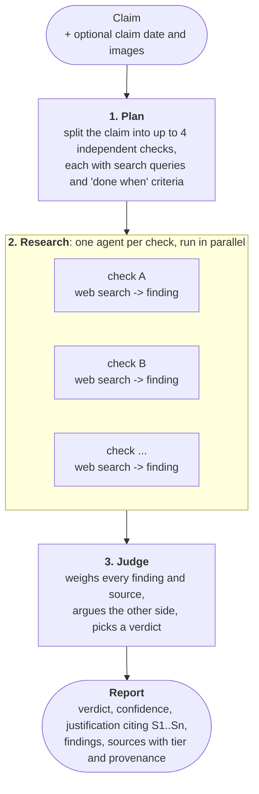

#  facticli
[](https://github.com/aic-factcheck/facticli/actions/workflows/ci.yml)

Claim extractor live at https://facticli.dyn.cloud.e-infra.cz/extract. How the fact-check pipeline works, with diagrams: [How the pipeline works](#-how-the-pipeline-works).

`facticli` is a pip-installable Python CLI for agentic claim verification with OpenAI-compatible inference APIs.

It restructures key ideas from `~/PhD/aic_averitec` (claim decomposition, evidence gathering, verdict synthesis) into a modular command-line multi-agent workflow with:
- open web search,
- orchestrated parallel subroutines,
- final veracity verdict + justification,
- explicit source output.

The pipeline is three model stages (`plan`, `research`, `judge`), each a markdown prompt written as a lane contract, with deterministic code between them: source authority tiers, a fact-checker blocklist and claim-date cutoff, a provenance label on every cited source, a hard search cap, a wrap-up call at the turn limit, and usage accounting that counts failed attempts. The code is deliberately small (a 2026-11 simplification removed the review loop, the single-agent baseline, token/retry budgets, citation health checks, and config profiles; see `TODO.md`).

## 📦 Install

From this repository:

```bash
pip install -e .
```

## ⚙️ Configure

Set the OpenAI-compatible endpoint, key, and model:

```bash
export OPENAI_API_BASE_URL=https://api.openai.com/v1
export OPENAI_API_KEY=...
export OPENAI_API_MODEL=gpt-5.4
```

Common base URLs:

```bash
# OpenAI
export OPENAI_API_BASE_URL=https://api.openai.com/v1
# Anthropic OpenAI SDK compatibility
# export OPENAI_API_BASE_URL=https://api.anthropic.com/v1/
# Gemini OpenAI compatibility
# export OPENAI_API_BASE_URL=https://generativelanguage.googleapis.com/v1beta/openai/
# Ollama at e-INFRA CZ
# export OPENAI_API_BASE_URL=https://llm.ai.e-infra.cz/v1
```

Optional retrieval defaults:

```bash
export FACTICLI_SEARCH_PROVIDER=openai
# only needed when FACTICLI_SEARCH_PROVIDER=brave
export BRAVE_SEARCH_API_KEY=...
# needed for reverse image search, on by default for claim images with a public URL
# (Serper runs Google Lens; Exa dates the pages it finds)
export SERPER_API_KEY=...
export EXA_API_KEY=...
```

## 🚀 Usage

Run a claim check:

```bash
facticli check "The Eiffel Tower was built in 1889 for the World's Fair."
```

Run with Brave Search API retrieval:

```bash
facticli check --search-provider brave "The Eiffel Tower was built in 1889 for the World's Fair."
```

Run with another OpenAI-compatible inference endpoint:

```bash
export OPENAI_API_BASE_URL=https://generativelanguage.googleapis.com/v1beta/openai/
export OPENAI_API_KEY=...
export OPENAI_API_MODEL=gemini-3.1-pro-preview

facticli check \
  --search-provider brave \
  "The Eiffel Tower was built in 1889 for the World's Fair."
```

Run with an Ollama-style OpenAI-compatible endpoint:

```bash
export OPENAI_API_BASE_URL=https://llm.ai.e-infra.cz/v1
export OPENAI_API_KEY=...
export OPENAI_API_MODEL=kimi-k2.5

facticli extract-claims \
  "In last year’s debate, the minister said inflation fell below 3% while wages rose 10%."
```

For full fact-check runs with third-party inference endpoints, prefer Brave search:

```bash
facticli check \
  --search-provider brave \
  "The Eiffel Tower was built in 1889 for the World's Fair."
```

Show the generated plan:

```bash
facticli check --show-plan "The Eiffel Tower was built in 1889 for the World's Fair."
```

Stream plan and per-check progress while the run executes:

```bash
facticli check --stream-progress "The Eiffel Tower was built in 1889 for the World's Fair."
```

Show token usage, cache hit rate, and per-stage stats:

```bash
facticli check --show-usage "The Eiffel Tower was built in 1889 for the World's Fair."
```

Route stages to different models or reasoning efforts (cheap research, frontier judge):

```bash
facticli check \
  --stage-model research=gpt-5-mini --stage-model judge=gpt-5.4 \
  --stage-effort research=low --stage-effort judge=high \
  "The Eiffel Tower was built in 1889 for the World's Fair."
```

Exclude fact-checking sites from evidence (label-leakage control) and persist run artifacts for audits:

```bash
facticli check --block-fact-checkers --artifacts-dir ./runs "The Eiffel Tower was built in 1889 for the World's Fair."
```

Record Brave responses and replay them on identical requests, so repeated or paired runs see the same retrieval:

```bash
facticli check --search-provider brave --search-cache-dir ./search-cache "The Eiffel Tower was built in 1889 for the World's Fair."
```

Machine-readable output:

```bash
facticli check --json --include-artifacts "The Eiffel Tower was built in 1889 for the World's Fair."
```

Print one skill's full prompt:

```bash
facticli skills --show judge
```

### Source provenance

Each research run keeps a journal of what its search tools returned. Every cited source is then compared with it by string matching, with no model call, and labelled in the report:

- `quote found in retrieved text` (`quote_matched`): a search returned the URL and the snippet occurs verbatim in the text returned for it.
- `url retrieved, quote not matched` (`url_matched`): a search returned the URL (or hosted search opened it), but the wording was not found in the returned text, the snippet is too short to check (under 15 characters), or there was no text to compare. Hosted OpenAI search reports only the URLs it consulted, so it never gets past this level.
- `NOT in search results` (`unmatched`): the URL was not in the search results of any check that cites it, or the judge listed a source no researcher cited. Typically a mis-copied URL. The judge is told, and such a source cannot carry the verdict on its own.

The label says where a source came from, not whether it is right. A source without a label was not assessed.

### Images

A claim can come with images: a photo it describes, a screenshot of a post, a chart. Pass each with `--image`, as a local file or an http(s) URL (JPEG, PNG, WebP, or GIF up to 20 MB):

```bash
facticli check "Photo shows a 101-year-old woman who has given birth to her 17th child." \
  --image https://example.com/viral-photo.jpg
```

- Every stage sees the images, each after a line naming its id (`image_1`, `image_2`, ...). The planner reads them as part of the claim. Researchers and the judge are told that what an image shows is what is being claimed, not evidence: evidence about an image still has to come from a source with a URL.
- Reverse image search is on by default when an image can be searched (see the next point); `--no-reverse-image-search` turns it off. It gives each researcher a `reverse_image_search(image_id, focus)` tool. Google Lens (through Serper) lists pages showing the same or a similar image; Exa then reads those pages for their publication date and a few sentences (focused on `focus`). Blocked domains are removed first, and under a claim date only pages dated on or before it are kept: a page Exa cannot date is dropped, because most later matches of a viral image are its fact-checks. Calls count against the search budget, are journaled for provenance, and are recorded by `--search-cache-dir`.
- Lens has to fetch the image itself, so the tool needs a public URL. An image given as a URL has one. For local files, mirror them somewhere public and pass the base with `--image-url-base URL`: `photo.jpg` is then searched as `URL/photo.jpg`. Images without a URL are still shown to the models, and without any searchable image the tool is not offered.
- On 20 AVerImaTeC dev claims (two runs each) the text alone got 8 and 9 right, the text with its images 9 and 10, and images with reverse image search 11 and 11. Images about double the tokens per claim. Details in `TODO.md`.
- The model has to accept image input. Images are sent as they are (no resizing); the provider scales them.
- Text-only claims send exactly the same requests as before images were supported.
- `extract-claims` takes `--image` too, so claims can be extracted from a screenshot alone or from a post's text together with its pictures.

The AVeriTeC runner reads each record's images from a list field (`--image-field`, default `images`; file names resolve against `--image-dir`, default the input file's directory). Missing image files stop the batch before the first claim. `scripts/fetch_averimatec.py` downloads the AVerImaTeC dev split from Hugging Face (`Rui4416/AVerImaTeC`) into that format, as `data/averimatec/dev.json` (152 claims) and a 20-claim label-stratified pilot `pilot_20.json` (`claim_id` = dev row index). The data is not in the repository. With `--image-url-base` the records point at a public copy of the images (for example, the `images/` folder of a GitHub repository holding the dataset's `images.zip`, with `#` in file names replaced by `_`), so no image directory is needed:

```bash
python3 scripts/fetch_averimatec.py --image-url-base https://raw.githubusercontent.com/heruberuto/averimatec_helper/main/images
python3 -m facticli.averitec_submission --input data/averimatec/pilot_20.json --output pilot.json \
  --search-provider exa --block-fact-checkers
```

### Limits and failures

- **Turn limit.** A research run that reaches its turn limit gets one more model call with tools disabled and answers from what it has. The finding is kept and marked `cut short at the turn limit`.
- **Search cap.** `--tool-call-budget` (default 8) is the number of searches a researcher is told to plan for per check. The brave, exa, and knowledge_store tools refuse calls beyond twice that number with a notice to answer, and the finding is marked `cut short at the search cap`. Hosted OpenAI search runs inside the provider and cannot be capped.
- **Fatal errors.** A rejected API key (the model's or Brave's), an exhausted quota, or an unknown model fails every later request the same way. The run stops with the error instead of judging the claim on no evidence.
- **Retries.** The OpenAI client retries a request that hit a transient error (429, 5xx, timeout, dropped connection) up to `--model-retries` times (default 3), honouring `Retry-After`. A research check that still fails is run once more; if that fails too it becomes a `failed` finding, which the judge treats as a missing observation.
- **Usage.** `--show-usage` counts every model attempt, including runs that failed, timed out, or were wrapped up, and shows cache-write tokens.

List built-in agent skills:

```bash
facticli skills
```

Generate an Averitec submission file from Averitec-formatted input claims:

```bash
python3 scripts/run_averitec_submission.py \
  --input data/averitec/dev.json \
  --output data/averitec/submission_generated.json \
  --search-provider openai
```

Notes:
- If input rows have no claim id field, fallback `claim_id` is the zero-based row index.
- Output rows follow Averitec format: `claim_id`, `claim`, `pred_label`, `evidence`.
- `evidence` entries include `question`, `answer`, `url`, `scraped_text`. Each entry states a different fact: every finding gets one row (question + summary) before any gets a second, and the remaining rows carry the sources' own snippets.
- The runner accepts the harness controls of `facticli check` (among them `--stage-model`, `--stage-effort`, `--service-tier`, `--tool-call-budget`, `--search-cache-dir`, `--block-fact-checkers`, `--artifacts-dir`) plus its own batch options; see `python3 -m facticli.averitec_submission --help`. `--claim-date-field` names the input field used as the evidence cutoff. Per-claim usage, failed and cut-short check counts, and source provenance counts land in the `.runinfo.json` manifest.
- A claim that fails gets a fallback `Not Enough Evidence` row. A fatal error (rejected key, exhausted quota, unknown model) stops the batch instead: completed rows are written, the exit code is 3, and `--resume` continues once the cause is fixed. `--fail-fast` stops the same way at any failure, with exit code 1. A claim date that cannot be parsed stops the batch before the first claim (exit code 2), because the evidence cutoff could not be applied.

Score a submission (label metrics, optional Ev2R), and measure verdict consistency across repeated runs (pass^k, pass@k, agreement, majority vote):

```bash
python3 -m facticli.averitec_eval --submission run1.json --gold data/averitec/dev.json
python3 -m facticli.averitec_eval --submission run1.json --submission run2.json --submission run3.json --gold data/averitec/dev.json
```

Audit persisted run artifacts for leakage (fact-checker sources, post-claim-date evidence), failures, cut-short checks, source provenance, budget use including tokens spent on failed attempts, and, optionally, evidence dependence (re-judge with the evidence removed; verdicts that survive were not evidence-driven):

```bash
python3 -m facticli.artifacts_audit --artifacts-dir ./runs --gold data/averitec/dev.json
python3 -m facticli.artifacts_audit --artifacts-dir ./runs --evidence-ablation --output audit.json
```

Extract decontextualized atomic check-worthy claims from arbitrary text:

```bash
facticli extract-claims "In last year’s debate, the minister said inflation fell below 3% while wages rose 10%."
```

Extract claims from a transcript file:

```bash
facticli extract-claims --from-file ./data/debate_excerpt.txt --json
```

### Multilingual extraction

Claim extraction is language-consistent: it detects the input language, returns
the extracted claims (and all coverage/exclusion notes) in that **same**
language, and preserves the original orthography (diacritics intact). It has
been validated on Czech, Slovak, and Polish in addition to English. The
detected language is reported as an ISO 639-1 code in `detected_language`.

```bash
facticli extract-claims "Premiér včera prohlásil, že ekonomika loni vzrostla o 2,3 procenta. Myslím, že je to skvělé."
```

```text
Detected Language
  cs

Claims
  - [claim_1] Ekonomika loni vzrostla o 2,3 procenta.
    source: ekonomika loni vzrostla o 2,3 procenta
    reason: Konkrétní ověřitelný číselný údaj.
```

## 🖥️ Web GUI (claim extraction)

A small branded web app exposes the claim-extraction workflow with a CEDMO
look-and-feel. It serves a single page plus a JSON `POST /api/extract`
endpoint, backed by the same `ClaimExtractionService` as the CLI.

Install the optional web extra and launch the server:

```bash
pip install -e ".[web]"

# Reads OPENAI_API_* from the environment or a local .env file.
python -m facticli.web
# -> http://127.0.0.1:8000
```

Configure host/port with `FACTICLI_WEB_HOST` / `FACTICLI_WEB_PORT`. The JSON
API can also be called directly:

```bash
curl -s http://127.0.0.1:8000/api/extract \
  -H "Content-Type: application/json" \
  -d '{"text": "Premiér včera prohlásil, že ekonomika loni vzrostla o 2,3 procenta.", "max_claims": 6}'
```

Interactive API docs are available at `/docs`.

## 🌐 Hosted demo

The extractor runs as a service at
**<https://facticli.dyn.cloud.e-infra.cz/extract>** (the bare host redirects
there, so additional tools can be mounted alongside it later).

The historical GitHub Pages address
<https://aic-factcheck.github.io/facticli/> is kept alive for backwards
compatibility: `pages/index.html` is a single self-contained page that
redirects to the service and links to it. It ships no credential and runs no
extraction. It deploys via `.github/workflows/pages.yml` (Settings → Pages →
Source: **GitHub Actions**).

## 🔐 API gatekeeping

Every credit-spending endpoint is gated by a shared API key, **on by default**.
If `FACTICLI_API_KEY` is unset the API fails closed (HTTP 503) rather than
opening; an unconfigured gate is never an open gate.

```bash
export FACTICLI_API_KEY=cedmo_2026              # required; clients send this
export FACTICLI_CORS_ORIGINS=https://aic-factcheck.github.io
export FACTICLI_RATE_LIMIT_REQUESTS=30          # per client, default 30
export FACTICLI_RATE_LIMIT_WINDOW=600           # seconds, default 600
export FACTICLI_ALLOWED_MODELS=gpt-5.6-terra,gpt-6.1-sol,gpt-6-luna
# export FACTICLI_API_AUTH=off                  # local development only
```

Clients authenticate with either header:

```bash
curl -s http://127.0.0.1:8000/api/extract \
  -H "Authorization: Bearer cedmo_2026" \
  -H "Content-Type: application/json" \
  -d '{"text": "Inflace loni klesla pod 3 procenta.", "max_claims": 6}'
```

`GET /api` and `GET /api/extract` document the API: a browser gets a readable
page, any other client gets the same facts as JSON. `GET /api/health`
(liveness) and `GET /api/models` (the selectable models) stay public too. Requests may set `text`, `max_claims` and `model`; the model must be one
the server allows, configured with `FACTICLI_ALLOWED_MODELS` (default
`gpt-5.6-terra,gpt-6.1-sol,gpt-6-luna`). Anything else is rejected with HTTP 400,
so a caller cannot spend this server's credits on an arbitrarily expensive model.
The provider base URL stays server-side only: a client able to redirect the
request would be handing it this server's credential.

## 🧰 CLI options

```text
facticli [--debug] <command>

facticli check [--model MODEL] [--base-url BASE_URL]
               [--stage-model STAGE=MODEL ...] [--stage-effort STAGE=EFFORT ...]
               [--model-retries N] [--service-tier {auto,default,flex,priority}]
               [--max-checks N] [--parallel N]
               [--search-provider {openai,brave,exa}]
               [--search-results N] [--search-context-size {low,medium,high}]
               [--tool-call-budget N] [--search-cache-dir DIR]
               [--block-fact-checkers] [--blocked-domain DOMAIN ...]
               [--image PATH_OR_URL ...] [--image-url-base URL]
               [--[no-]reverse-image-search]
               [--artifacts-dir DIR]
               [--show-plan] [--show-usage] [--stream-progress]
               [--json] [--include-artifacts]
               "<claim>"

facticli extract-claims [--from-file PATH] [--image PATH_OR_URL ...]
                        [--model MODEL] [--base-url BASE_URL]
                        [--stage-model STAGE=MODEL ...] [--stage-effort STAGE=EFFORT ...]
                        [--max-claims N] [--json]
                        [text]

facticli skills [--show NAME]
```

Validation notes:
- `--max-checks`, `--parallel`, `--max-claims`, and `--tool-call-budget` must be integers `>= 1`; `--model-retries` must be `>= 0`.
- `--search-results` must be an integer in `1..20`; it is the result count the brave, exa, and knowledge_store tools use when the model does not ask for one.
- `--search-cache-dir` needs `--search-provider brave` or `exa`.
- The `knowledge_store` provider needs a store directory and claim ids, so only the AVeriTeC runner offers it (`--knowledge-store-dir`); `check` refuses it, also when it comes from `FACTICLI_SEARCH_PROVIDER`.
- `--stage-model` / `--stage-effort` take `STAGE=VALUE` with stages `plan`, `research`, `judge`, `extract_claims`; efforts are `none`, `minimal`, `low`, `medium`, `high`, `xhigh`, `max` (the provider decides which a model accepts).
- For `extract-claims`, provide either positional `text` or `--from-file`, but not both; with `--image`, the text may be left out.
- `--image` takes a local file or an http(s) URL; an image that is missing, over 20 MB, or not JPEG, PNG, WebP, or GIF exits with code 2 before any model call.
- Reverse image search runs by default when a claim image has a public URL, and then needs `SERPER_API_KEY` and `EXA_API_KEY` (exit 2 without them; `--no-reverse-image-search` skips it). `--reverse-image-search` warns when no image has a public URL.

## 🧠 How the pipeline works

### At a glance



Three model roles (planner, researcher, judge), each a separate prompt in `src/facticli/prompts/`. Only the researcher can search. A claim's images go to all three (see [Images](#images)). Everything between the model calls is deterministic code: it never asks a model to check another model's work when a comparison can do it.

| Stage | What the model does | What the code does around it (no model) |
| --- | --- | --- |
| 1. Plan | Splits the claim into checks, each a question with search queries and acceptance criteria. | Caps checks (4) and queries (5); falls back to one direct check if the plan is empty. |
| 2. Research | Searches the web for one check and writes a finding: `supports` / `refutes` / `mixed` / `insufficient`, with quoted sources. | Runs checks in parallel with a timeout and one retry. Records every search result in a journal, refuses searches past the cap, labels each cited source by provenance and authority tier, and removes sources from blocked domains or published after the claim date. |
| 3. Judge | Reads findings grouped by signal and a numbered source table, writes the strongest counter-argument, then the verdict. | Keeps the researchers' findings as the record, labels sources the judge added itself, flags cited ids that do not exist. |

Verdicts: `Supported`, `Refuted`, `Not Enough Evidence`, `Conflicting Evidence/Cherrypicking`.

### Full pipeline

Defaults are shown in brackets.

```mermaid
flowchart TD
  entry["<b>facticli check</b> or the AVeriTeC batch runner"] --> cfg["Flags + environment<br/>check API keys, build the three stages"]
  cfg --> ctx["<b>Open the run</b><br/>constraints: blocked domains, evidence cutoff = claim date,<br/>reference date = claim date or today<br/>claim images (sent to every stage after the payload)<br/>usage ledger; 429/5xx/timeouts retried by the client [3]"]
  ctx --> planner

  subgraph PLAN["1. Plan"]
    planner["Planner model<br/>claim, max checks [4]"] --> pnorm["Normalize: at most 4 checks, 5 queries each<br/>empty plan: one direct check"]
  end

  pnorm --> fan["One task per check<br/>at most 4 at once [--parallel]"]

  subgraph RES["2. Research, for each check"]
    fan --> attempt["Attempt [up to 2, 120 s each; 600 s on flex]<br/>with a fresh retrieval journal"]
    attempt --> rmodel["Researcher model<br/>payload: reference date, claim, check, criteria,<br/>search budget [8], cutoff and blocklist"]
    rmodel <-->|"tool calls"| tool["Search tool<br/>brave / exa: date cutoff sent, blocked domains dropped,<br/>results and text recorded in the journal,<br/>refused past the cap [16], optional record/replay cache<br/>openai hosted [default]: consulted URLs recorded<br/>reverse image search [on for images with a public URL]: Lens matches,<br/>dated through Exa, undated or later pages dropped under a cutoff"]
    rmodel -->|"turn limit [10]"| wrap["Wrap-up: one call with tools off,<br/>answer from what was found"]
    rmodel --> outcome{"outcome"}
    wrap --> outcome
    outcome -->|"finding"| ground["Reset fields the model may not set<br/>label sources: quote_matched / url_matched / unmatched<br/>tier sources: primary ... user_generated<br/>drop blocked or too-recent sources"]
    outcome -->|"error"| kind{"error kind"}
    kind -->|"timeout, invalid output, network:<br/>next attempt"| attempt
    kind -->|"bad request, refusal,<br/>or attempts used up"| failed["finding: failed<br/>(a missing observation, not evidence)"]
    kind -->|"fatal: rejected key, no quota, unknown model"| abort(["Abort the whole run<br/>batch runner: exit 3"])
  end

  ground --> findings["Findings, in plan order<br/>cut-short ones carry stop_reason"]
  failed --> findings

  subgraph JUDGE["3. Judge"]
    findings --> judge["Judge model<br/>payload: reference date, findings grouped by signal,<br/>source table S1..Sn with snippets and tiers,<br/>failed checks listed as missing"] --> jpost["Researchers' findings stay the record<br/>sources the judge added: unmatched<br/>merge, deduplicate, tier sources<br/>cited ids with no source: reported"]
  end

  jpost --> post["<b>Close the run</b><br/>usage of every attempt, including failed ones<br/>retrieval summary, artifacts saved [--artifacts-dir]"] --> out{"output"}
  out -->|"text"| txt["Report with tiers, provenance labels,<br/>cut-short and failed markers<br/>[--show-usage: tokens, cache, retrieval]"]
  out -->|"--json"| js["Report JSON<br/>[--include-artifacts: plan, findings, artifacts]"]
```



How to read the labels in the report:

- **Provenance** (`grounding`) says where a source came from, not whether it is right. `quote found in retrieved text`: the search returned the URL and the quoted snippet. `url retrieved, quote not matched`: the URL was returned but the quote was not found (hosted OpenAI search never returns text, so its sources stop here). `NOT in search results`: the URL never came back from a search of that check; usually a mis-copied URL. See [Source provenance](#source-provenance).
- **Tier** is the kind of publisher, from a domain table: `primary`, `reference`, `news`, `fact_checker`, `user_generated`, `other`.
- **Cut short**: the check reached its turn limit or search cap and answered from what it had.
- **Failed**: the check could not run; the judge is told it is missing, not evidence of absence.

`facticli extract-claims` (and the web GUI) is a separate single-step path: one model call turns text into check-worthy claims, with no search, journal, or run ledger.

Inference: one OpenAI Agents SDK path for every OpenAI-compatible endpoint (`OPENAI_API_BASE_URL`, `OPENAI_API_KEY`, `OPENAI_API_MODEL`); `--stage-model` and `--stage-effort` route single stages to another model or reasoning effort. Prompts are markdown lane contracts (Purpose, Non-goals, Inputs, Procedure, Failure handling, Output contract); `facticli skills --show NAME` prints one.

## 🗂️ Repository layout

```text
src/facticli/
  pipeline.py          # plan -> parallel research -> judge; claim extraction; artifacts
  llm.py               # the only Agents SDK code: client setup, search tools, StageRunner (usage hooks, wrap-up call)
  payloads.py          # stage inputs as pure functions (grouped judge payload, source table)
  config.py            # runtime config dataclasses and stage routing
  core/
    contracts.py       # typed plan/finding/report/extraction contracts (status, tiers, grounding, criteria, counter-argument)
    normalize.py       # deterministic normalization helpers
    artifacts.py       # run artifact schemas (error kinds, stage models, retrieval receipts)
    errors.py          # error taxonomy (ErrorKind, classify_exception, is_fatal)
    usage.py           # usage events for every attempt
    retrieval.py       # retrieval journal: tool-call receipts, hard search cap
    grounding.py       # deterministic provenance label for cited sources
    search_cache.py    # record/replay directory for search responses
    source_quality.py  # deterministic source authority tiers
    truncation.py      # tool-output cleaning and truncation + untrusted-content notice
    constraints.py     # retrieval constraints (blocklist, claim-date cutoff)
    images.py          # claim images: loading, format check, per-run image context
  cli.py               # command-line interface
  check_options.py     # flags, env checks, and runtime config shared by `check` and the AVeriTeC runner
  brave_search.py, exa_search.py, knowledge_store.py  # search tools (bounded output, journaled, capped)
  reverse_image_search.py  # Lens matches for a claim image, dated through Exa, same controls as search
  skills.py            # skill registry + frontmatter-aware prompt loading
  artifacts_audit.py   # leakage / robustness / evidence-ablation audit over persisted runs
  averitec_submission.py, averitec_eval.py, eval/  # AVeriTeC batch runner, scorer, Ev2R, consistency
  web/                 # optional FastAPI GUI for claim extraction
  prompts/             # skill prompts as lane contracts with frontmatter
    plan.md  research.md  judge.md  extract_claims.md
```

## 📓 Demo notebooks

Interactive demos live in `/Users/bertik/PhD/facticli/notebooks`:

- `01_planner_subroutine_demo.ipynb`
- `02_research_subroutine_demo.ipynb`
- `03_judge_subroutine_demo.ipynb`
- `04_full_checker_demo.ipynb`
- `05_claim_extraction_demo.ipynb`
- `06_averitec_submission_workflow.ipynb`

Each notebook includes:
- auto-reload setup (`%load_ext autoreload`, `%autoreload 2`),
- emoji-based headings for quick navigation,
- multiple example claims as commented-out variable redefinitions.

## ✅ Testing

Run the integrated unit tests:

```bash
python3 -m unittest discover -s tests -p "test_*.py" -v
```

Run the standard test routine (loads `.env` if present):

```bash
./scripts/test_routine.sh
```

Run with live smoke enabled:

```bash
./scripts/test_routine.sh --live-smoke
```

Notes:
- Live smoke tests are guarded by `FACTICLI_RUN_LIVE_SMOKE=1`.
- The live smoke test currently validates the OpenAI profile path.

## 🤖 GitHub automation

This repo includes two GitHub Actions workflows:
- `.github/workflows/ci.yml`: runs on every push and pull request (compile + CLI checks + unit tests).
- `.github/workflows/live-smoke.yml`: one real `facticli check` against the OpenAI API, started by hand from the Actions tab (`Run workflow`). It has no schedule, so it spends nothing unless someone runs it.

To use live smoke in GitHub:
1. Go to repository `Settings` -> `Secrets and variables` -> `Actions` and add the secret `OPENAI_API_KEY` (without it the test skips).
2. Change `OPENAI_API_MODEL` in `.github/workflows/live-smoke.yml` to test another model.
3. To run it on a schedule, add a `schedule:` trigger to the workflow; its failure emails go to whoever last edited the cron line.

## 🤝 Contributor guide

- Project contributor/agent guidance lives in `/Users/bertik/PhD/facticli/AGENTS.md`.
- `/Users/bertik/PhD/facticli/CLAUDE.md` is a symlink to the same file.

## 📝 Notes

- This is an initial bootstrap and intentionally leaves room for deeper evaluator tooling, benchmark harnesses, and richer source quality scoring.
- If you installed in editable mode, updates in `src/` are reflected immediately.

## 📄 License

CC-BY-SA-4.0
